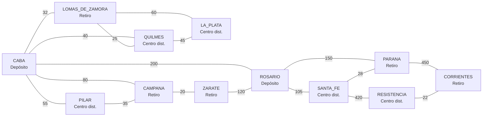

# Red Logística de un E-commerce de Perfumería

TPO 2026 — Programación III (UADE) — comisión Miércoles Mañana.

API REST (Java 21 + Spring Boot 3 + Neo4j) que modela la red de distribución de un e-commerce de perfumería y
resuelve sobre ella los algoritmos de la materia: recorridos, caminos mínimos, árboles de expansión mínima,
ordenamiento, greedy, programación dinámica, todos contra todos, backtracking y branch & bound.
Todos los algoritmos están implementados desde cero (sin `Collections.sort`, sin `PriorityQueue`, sin librerías de grafos).

## Dominio

| Concepto | En este proyecto |
|----------|------------------|
| **Dominio** | Red logística de un e-commerce de perfumería en Argentina |
| **Nodo** | Un depósito principal, un centro de distribución o un punto de retiro, ubicado en una localidad real (CABA, Quilmes, Rosario, Corrientes…) |
| **Arista** | Una ruta física terrestre entre dos nodos. El grafo es **no dirigido**: la ruta se recorre en ambos sentidos |
| **Costo de la arista** | **Tiempo de viaje en minutos** (entero positivo) |
| **Ítem** | Una caja de perfumes con un **peso en kg** y un **valor comercial en USD**, que se entrega en un nodo destino |

Los tiempos de la semilla son estimaciones redondeadas pensadas para trabajar los algoritmos, no para planificar un
viaje real. Todas las aristas tienen un peso distinto, así el árbol de expansión mínima es único (907 min) y se verifica a mano.

### Grafo semilla (12 nodos, 17 aristas)



### Cajas de perfumes (semilla)

| Id | Descripción | Peso (kg) | Valor (USD) | Destino |
|----|-------------|-----------|-------------|---------|
| PQ-01 | Caja Perfumes de Nicho x4 | 8 | 520 | QUILMES |
| PQ-02 | Caja Eau de Parfum Dama x6 | 12 | 540 | LA_PLATA |
| PQ-03 | Caja Eau de Toilette Caballero x12 | 18 | 760 | PILAR |
| PQ-04 | Caja Colonias Familiares x24 | 25 | 900 | ROSARIO |
| PQ-05 | Caja Sets de Regalo x8 | 15 | 600 | CAMPANA |
| PQ-06 | Caja Body Mist x30 | 20 | 480 | SANTA_FE |
| PQ-07 | Caja Perfumes Árabes x6 | 10 | 660 | LOMAS_DE_ZAMORA |
| PQ-08 | Caja Testers x40 | 6 | 150 | CORRIENTES |

Con una camioneta de 40 kg el greedy por ratio valor/peso arma una carga de 1870 USD y la mochila 0/1 una de 1960 USD:
es el caso donde el greedy falla (ver `GET /api/paquetes/greedy`). Y si las 8 cajas (114 kg) se reparten entre 3
camionetas, el greedy LPT deja la más cargada con 40 kg y el branch & bound encuentra un reparto con 39 kg como máximo
(ver `GET /api/reparto/cajas?camionetas=3`).

## Integrantes

| Apellido y nombre | Usuario de GitHub | Legajo |
|-------------------|-------------------|--------|
| Acosta Gonzalo | [gonzaloacosta5](https://github.com/gonzaloacosta5) | 1173449 |
| Lopez Bautista | [bautilopezl](https://github.com/bautilopezl) | 1172886 |
| Margets Lucas | [LucasMargets11](https://github.com/LucasMargets11) | 1171541 |

## Cómo ejecutarlo

Requisitos: JDK 21 y Docker (para Neo4j). El Maven Wrapper ya está incluido (`mvnw`, `mvnw.cmd` y `.mvn/`), así que no
hace falta instalar Maven (en Windows usá `mvnw.cmd` en lugar de `./mvnw`).

1. **Credenciales (nunca en el repositorio).** Copiá la plantilla y completá la contraseña de Neo4j (8 caracteres o
   más). El usuario ya viene como `neo4j`: es el único que la imagen oficial de Neo4j acepta como usuario inicial
   (con otro, el contenedor se detiene con `Invalid admin username, it must be neo4j`).

   ```bash
   cp .env.example .env
   # editá .env: NEO4J_PASSWORD=...
   ```

   `.env` está en `.gitignore`. Si preferís variables de entorno del sistema, en PowerShell:

   ```powershell
   $env:NEO4J_USERNAME = "neo4j"; $env:NEO4J_PASSWORD = "..."
   ```

2. **Levantar Neo4j.** `docker compose` lee el `.env` de esta carpeta por sí solo (o las variables del sistema);
   si falta `NEO4J_USERNAME` o `NEO4J_PASSWORD`, se detiene y lo avisa:

   ```bash
   docker compose up -d
   ```

3. **Arrancar la API** desde la carpeta del proyecto (así encuentra el `.env`):

   ```bash
   ./mvnw spring-boot:run
   ```

   Si la base está vacía, la aplicación carga sola la red semilla (12 nodos, 17 rutas, 8 cajas) antes de empezar a
   atender pedidos. Comprobación: `curl http://localhost:8080/api/grafo/resumen`.

4. **Correr los tests** (no necesitan Neo4j):

   ```bash
   ./mvnw test
   ```

Si Neo4j está caído, la API arranca igual (unos 30 s más tarde, porque el driver reintenta la conexión) y responde
`503` con un mensaje claro (no un stack trace); si falta `NEO4J_USERNAME` o `NEO4J_PASSWORD`, la aplicación no arranca
y el log indica qué propiedad no se pudo resolver.

## Arquitectura

```
controller  ──►  service  ──►  algorithm      (lógica pura, sin Spring ni base de datos)
                    │             ▲
                    ▼             │ usa solo
                repository     model + GrafoMemoria
                    │
                  Neo4j
```

| Paquete | Responsabilidad |
|---------|-----------------|
| `model` | Records `Nodo`, `Ruta`, `Paquete` y enum `TipoNodo` |
| `repository` | `GrafoRepository` y su implementación con el driver oficial de Neo4j (`Neo4jGrafoRepository`); `DatosSemilla` y `CargadorSemilla` |
| `service` | Carga el grafo **una vez por solicitud** en una `GrafoMemoria`, valida y normaliza parámetros, llama al algoritmo y arma la respuesta |
| `algorithm` | Los algoritmos, más sus estructuras propias: `estructura.GrafoMemoria` (lista de adyacencia), `MinHeap`, `UnionFind` y `ordenamiento.Ordenamiento` |
| `controller` | Controllers delgados: reciben parámetros y delegan en un servicio (sin `if`, `for` ni `while`) |
| `exception` | `@RestControllerAdvice` que traduce toda excepción a un JSON de error uniforme |

### Reglas del TPO y cómo se cumplen

| Regla | Cómo se cumple | Quién la verifica |
|-------|----------------|-------------------|
| Lógica algorítmica solo en `algorithm` | Los controllers no tienen bucles ni condicionales y no importan `repository`, `algorithm.estructura` ni `algorithm.ordenamiento` y no instancian `MinHeap`, `UnionFind` ni `Ordenamiento` | `ArquitecturaTest` |
| Los algoritmos no consultan la base | `algorithm` no importa Spring, Neo4j, `repository` ni `service`; recibe un `GrafoMemoria` ya cargado | `ArquitecturaTest` |
| Sin stack traces en los endpoints | `ManejadorErrores` devuelve `ErrorRespuesta` (400/404/405/422/503/500) y el `500` genérico solo registra en el log; `server.error.include-stacktrace=never` | `ManejadorErroresTest` |
| Sin librerías externas para los algoritmos | No se usan `sort`, `sorted`, `PriorityQueue`, `TreeMap` ni librerías de grafos dentro de `algorithm` | `ArquitecturaTest` |
| Sin credenciales en el repositorio | `application.properties` lee `${NEO4J_USERNAME}` y `${NEO4J_PASSWORD}` **sin valor por defecto**; `.env` está ignorado | `ArquitecturaTest`; el historial completo se revisó antes de la entrega |

## Algoritmos y endpoints

Cada algoritmo tiene su ficha en **[docs/ENDPOINTS.md](docs/ENDPOINTS.md)**: parámetros, JSON de ejemplo
(salida real sobre la semilla), complejidad temporal y espacial con su justificación, y casos de error.
Todas las URLs usan `http://localhost:8080`, el puerto por defecto de Spring Boot (no se configura otro en
`application.properties`). La colección de Postman
**[docs/postman/TPO-Logistica-Perfumeria.postman_collection.json](docs/postman/TPO-Logistica-Perfumeria.postman_collection.json)**
define la variable `baseUrl` con ese mismo valor.

| Algoritmo | Endpoint | Complejidad temporal |
|-----------|----------|----------------------|
| BFS | `GET /api/recorridos/bfs?origen=CABA` | O(V + E) |
| DFS | `GET /api/recorridos/dfs?origen=CABA` | O(V + E) |
| Dijkstra | `GET /api/caminos/dijkstra?origen=CABA&destino=CORRIENTES` | O((V + E) log V) |
| Prim | `GET /api/mst/prim?origen=CABA` | O(E log V) |
| Kruskal + Union-Find | `GET /api/mst/kruskal` | O(E log E) = O(E log V) |
| QuickSort | `GET /api/paquetes/ordenar/quicksort?criterio=valor&orden=desc` | O(n log n) promedio, O(n²) peor |
| MergeSort | `GET /api/paquetes/ordenar/mergesort?criterio=peso&orden=asc` | O(n log n) siempre |
| Greedy (+ contraejemplo) | `GET /api/paquetes/greedy?capacidadKg=40`, `/greedy/contraejemplo` | O(n log n) |
| Mochila 0/1 | `GET /api/paquetes/mochila?capacidadKg=40&incluirTabla=true` | Θ(n · W) |
| Floyd-Warshall | `GET /api/caminos/floyd-warshall` (+ `/camino`, `/demo-ciclo-negativo`) | Θ(V³) |
| Backtracking | `GET /api/backtracking/rutas?origen=CABA&destino=QUILMES&maxMinutos=100&maxSaltos=3` | O(V!) peor caso, con poda mucho menos |
| Branch & Bound (orden de entrega) | `GET /api/reparto/branch-and-bound?origen=CABA&destinos=QUILMES,LA_PLATA,PILAR` | O(k! · k²) peor caso (k destinos), con cota mucho menos |
| Branch & Bound (reparto de carga) | `GET /api/reparto/cajas?camionetas=3` | O(kⁿ) peor caso (n cajas, k camionetas), con cota mucho menos |

## Tests

`./mvnw test` ejecuta, con JUnit 5, las 108 pruebas automatizadas; todas pasan:

- Un test por algoritmo (`DijkstraTest`, `FloydWarshallTest`, `MochilaDPTest`, `BacktrackingTest`, `BranchAndBoundTest`,
  `BranchAndBoundCargaTest`, …),
  con casos a mano sobre la semilla, casos borde (nodo aislado, ciclo negativo, capacidad 0, entradas inválidas) y comparaciones
  contra fuerza bruta sobre entradas aleatorias con semilla fija.
- `ServiciosTest`: la cadena servicio → algoritmo con un repositorio en memoria (sin Neo4j).
- `ArquitecturaTest`: lee el código fuente y falla si un controller tiene lógica, si `algorithm` consulta la base o usa
  librerías prohibidas, o si hay credenciales en el repositorio.
- `ManejadorErroresTest`: comprueba con MockMvc que los errores salen como JSON y sin stack trace.

## Uso de IA

- **Herramientas:** Claude (Anthropic) como asistente de programación, y Claude Code para la revisión final de la
  entrega.
- **Para qué se usó:** generar la estructura inicial del proyecto, la implementación de los algoritmos y de sus
  estructuras de datos, los controllers y servicios, los tests JUnit 5, `docs/ENDPOINTS.md` y este README. En la
  revisión final, Claude Code contrastó el proyecto con la consigna, agregó el reparto de cajas entre camionetas
  (`BranchAndBoundCarga`), hizo que la semilla termine de cargarse antes de atender pedidos, dio permiso de ejecución
  a `mvnw` y completó la documentación. Esos commits figuran con Claude como coautor.
- **Prompt principal:** se le pidió actuar como desarrollador backend senior en Java 21, Spring Boot 3 y Neo4j, con el
  dominio, las reglas arquitectónicas, los algoritmos y los entregables de la consigna del TPO.
- **Qué hizo el grupo:** cada integrante leyó el código generado y puede explicar cada algoritmo.
- **Cómo se validó:** las 108 pruebas automatizadas pasan con `./mvnw test`; la API se levantó contra Neo4j 5.26 en
  Docker y se probaron todos los endpoints, que devolvieron los mismos resultados que `docs/ENDPOINTS.md`; y se
  revisó el historial completo de commits sin encontrar credenciales.
- **Comprensión del código:** el Segundo Parcial es una instancia de código en vivo, sin IA y sin acceso al repositorio.
  Todos los integrantes deben poder explicar y reescribir cada algoritmo (invariante, complejidad, estructuras de datos).

## Seguridad

- No hay credenciales en el código ni en `application.properties`; se leen de `NEO4J_USERNAME` / `NEO4J_PASSWORD`
  (variables de entorno o `.env` local ignorado por git).
- Antes de la entrega se revisó el historial completo (todas las ramas): ningún commit contiene una contraseña. Si
  alguna vez se sube una, hay que cambiarla: borrar el archivo en un commit nuevo no la elimina del historial.
- Los endpoints devuelven errores manejados con un cuerpo uniforme; nunca stack traces ni mensajes internos.
- Las búsquedas exhaustivas (backtracking y branch & bound) tienen un tope de nodos explorados; al superarlo responden
  `422` en lugar de dejar el servidor colgado.
